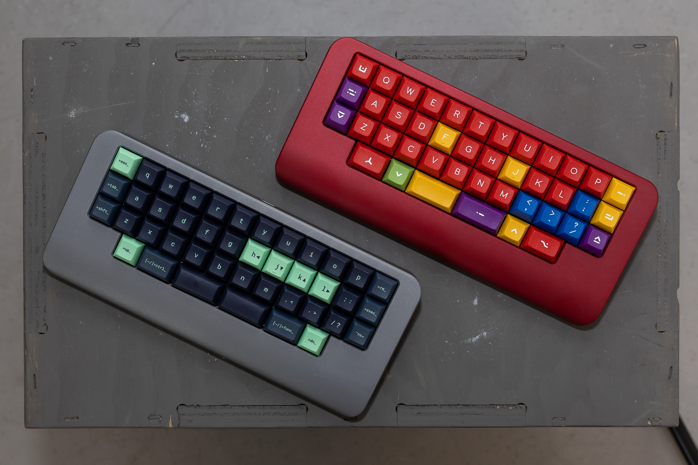

# Boards
### [Back to main list of boards](https://github.com/MakerJake01/MakerJakes-keyboards) 

## The J42K is a bottom mount 12u HHKB ortho hotswap keyboard.

This keyboard is the third iteration is the [J42K](https://github.com/MakerJake01/MakerJakes-keyboards/tree/main/J42K) series. It has a center mount UDB. The bottom row layouts remain the same from previous versions. 

# Pcb
The first version of the PCB was designed with an Atmega32u2 and the second version used in the GB has an STM32f07. In the PCB folder you can find production files to get this board manufactured for yourself. The attached files were used for the GB production and function.

# Case
The case has been designed to be milled out of aluminum. The attached files in the [case](https://github.com/MakerJake01/MakerJakes-keyboards/tree/main/J42KBm/Case) folder will be sufficient to get this manufactured for yourself. 

# Firmware 
The vial firmware for this keyboard is attached to this repo in case you need to re-flash the board. The vial source is also included in case you want to modify it.

# Parts
| Part        | Number      | Note |
| :---        |    :----:   |          ---: |
| PCB   | 1  |  |
| Plate | 1 | |
| Universal Daughter board | 1 | |
| JST Cable |
| M2x4 Screw | 8 | | 

# Build Notes

The JST cable needs to folded into the slot to ensure the cable does not interfere with the PCB.

# Where to Buy 
change this at some point. To get the most info join my discord server. You can buy and print the parts needed youself. 

Go to the `#choose-roles` channel and type 
~~~
!join 
~~~

 