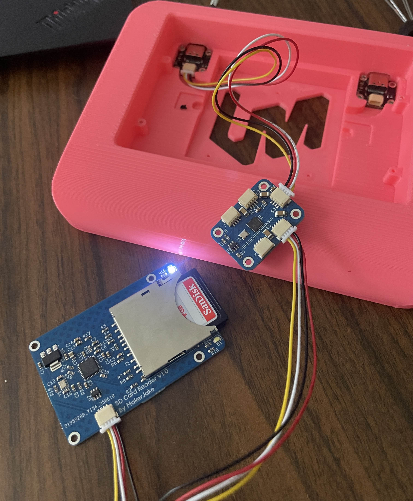
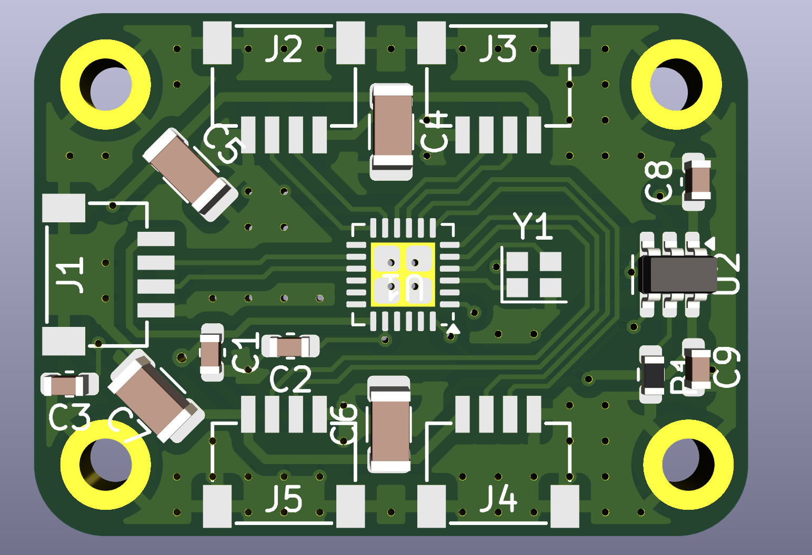
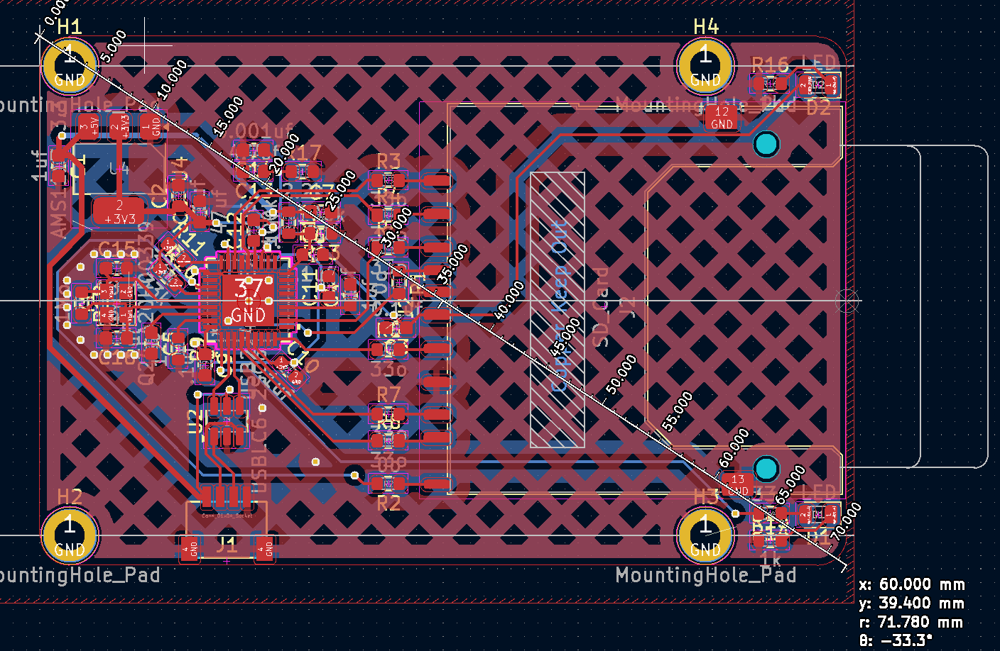

# Boards
### [Back to main list of boards](https://github.com/MakerJake01/MakerJakes-keyboards) 

## This is a modular USB hub system built around the Mdhcudbcusbhb with peripheral boards made to be compatible with the UDB JST cable.

The heart of this system is the maybe dumb hopefully cool udb compat usb hub board (mdhcudbcusbhb). This uses the same JST connector as as the Unified Daughterboard Project.These should only be used for the host port and not for downstream ports. In addition to UDB keyboard the only downstream devices that exist is a USB A port and SD card reader.

More information about each device is included in the provided folders.

More work is needed to include board step files and implementation specifics to help with board designs.

## [Mdhcudbcusbhb](https://github.com/MakerJake01/MakerJakes-keyboards/tree/main/ModularUSBHub/Mdhcudbcusbhb)

## [USB A](https://github.com/MakerJake01/MakerJakes-keyboards/tree/main/ModularUSBHub/USB_A)

## [SD Card](https://github.com/MakerJake01/MakerJakes-keyboards/tree/main/ModularUSBHub/SD_Card)
